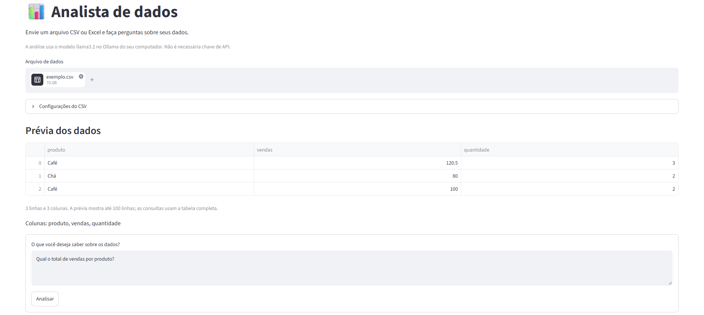
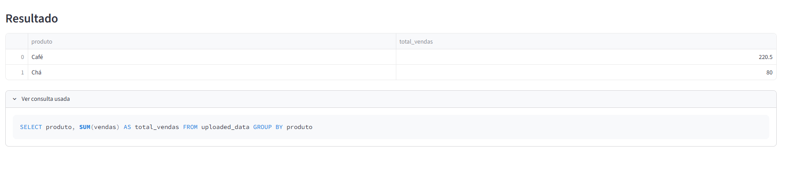

# Analista de dados com Ollama

Aplicativo local para fazer perguntas em português sobre dados de arquivos CSV ou Excel. O aplicativo usa Streamlit para a interface, Ollama com o modelo `llama3.2:latest` para criar consultas SQL e DuckDB para executá-las em memória. Não é necessária uma chave de API.

## Imagens do aplicativo

Prévia dos dados e pergunta sobre o arquivo de exemplo:



Resultado da análise e consulta SQL utilizada:



## Requisitos

- Python instalado e disponível no terminal (instalação testada com Python 3.14).
- Ollama instalado e em execução.
- Modelo `llama3.2` baixado no Ollama.
- Conexão com a internet para instalar as bibliotecas e baixar o modelo na primeira utilização.
- Memória suficiente para carregar os dados e executar o modelo.

Para baixar o modelo, execute uma vez no terminal:

```powershell
ollama pull llama3.2
```

## Executar no Windows

1. Abra o Ollama e mantenha-o em execução.
2. Dê dois cliques em `iniciar_local.bat`. Na primeira execução, ele cria um ambiente virtual `.venv` na pasta do projeto e instala as dependências.
3. Mantenha a janela do terminal aberta enquanto usa o aplicativo. O navegador deve abrir automaticamente.
4. Envie um arquivo CSV ou XLSX e faça uma pergunta sobre os dados.

## Executar pelo terminal

No PowerShell, dentro da pasta do projeto:

```powershell
python -m venv .venv
.\.venv\Scripts\python.exe -m pip install -r requirements_local.txt
.\.venv\Scripts\python.exe -m streamlit run app_local.py --server.address localhost
```

O Ollama deve estar em execução antes de enviar uma pergunta. Para conferir os modelos disponíveis, use `ollama list`.

## Exemplo

Envie o arquivo `exemplo.csv`. Em **Configurações do CSV**, escolha `;` como separador e `,` como separador decimal. Pergunte: “Qual o total de vendas por produto?”

O resultado esperado é **Café: 220,50** e **Chá: 80,00**.

## Como funciona e limitações

- O aplicativo lê a primeira aba de arquivos Excel. A prévia mostra até 100 linhas, mas as consultas usam todas as linhas carregadas.
- Para CSV, é possível ajustar o separador, a codificação e o separador decimal.
- O modelo recebe a pergunta e os nomes e tipos das colunas para gerar uma consulta SQL. Cada pergunta é independente, sem histórico de conversa.
- As consultas são executadas em um banco DuckDB em memória. O aplicativo limita a exibição a 1.000 linhas de resultado.
- A IA pode cometer erros; confira a consulta exibida e valide resultados importantes, especialmente números e datas.
- O `.gitignore` exclui planilhas e CSVs locais por padrão, com exceção de `exemplo.csv`, para ajudar a evitar a inclusão acidental de dados privados no Git.

## Comportamento atual e testes

O CSV é lido com pandas: o separador pode ser automático, `;`, `,` ou tabulação; a codificação pode ser `utf-8-sig`, `cp1252` ou `latin-1`; o separador decimal pode ser `.` ou `,`. As opções padrão são automático, `utf-8-sig` e `.`. O XLSX é lido pela primeira aba, com `openpyxl`, sem opção de seleção de aba. Todo o arquivo é carregado em memória; a prévia mostra até 100 linhas. A consulta usa a tabela completa `uploaded_data` e exibe até 1.000 linhas do resultado.

Um arquivo lido sem linhas de dados gera um aviso; um arquivo CSV totalmente vazio, codificação incompatível ou XLSX inválido pode gerar erro de leitura. A interface apresenta mensagens específicas para falhas de leitura, modelo e consulta sem exibir o texto das exceções. Na análise, o modelo tem até três tentativas de consulta, e o DuckDB valida uma única instrução de leitura com acesso externo desabilitado. O limite de exibição não limita o custo da consulta. Não há resposta textual fundamentada no resultado nesta versão.

Para executar os testes automatizados no PowerShell, após instalar as dependências do projeto na `.venv`:

```powershell
.\.venv\Scripts\python.exe -m unittest discover -s tests -v
```

Os testes usam arquivos sintéticos e o `exemplo.csv`, simulam a interface e o cliente Ollama, verificam os serviços isoladamente e executam consultas no DuckDB real. Não exigem o serviço Ollama. Eles não substituem uma verificação manual no navegador com o modelo local.
